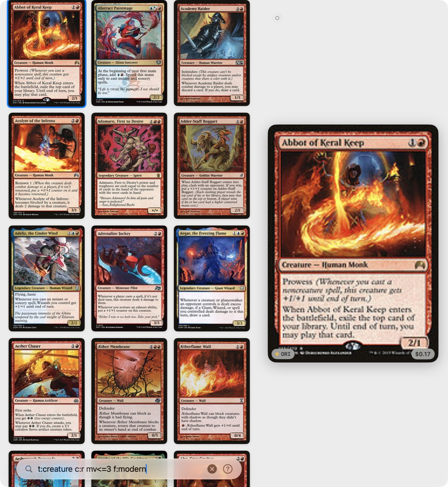

# Tutor

Instant, offline card search for Magic: The Gathering, for macOS. Type a Scryfall-style query and the results update as you type, from a local SQLite database, with no network call on the search path.



## Features

- **Fast.** Most queries run in a few milliseconds against the full card pool. Run `Tutor --bench` to measure on your machine.
- **Scryfall search syntax.** Colours, identity, types, oracle text, mana value, power/toughness, rarity, sets, formats, keywords, prices and more. The `?` button in the search bar lists everything.
- **Offline-first.** Card data is a one-time ~80 MB download from Scryfall bulk files. Images are fetched lazily, cached, and pre-warmed for the cards around your selection.
- **Keyboard-first.** Arrow through results, flip double-faced cards, copy names or full details, jump to Scryfall.
- **Favourites** sort to the top of results.
- **Prices and legality** at a glance, refreshed per card.

## Install

Tutor isn't signed or notarised, so build it yourself. That takes under a minute and needs only the Xcode Command Line Tools (`xcode-select --install`), not full Xcode.

```sh
git clone https://github.com/<you>/tutor.git
cd tutor
Scripts/build_app.sh
open dist/Tutor.app
```

Requires macOS 14 or later. Builds natively for the machine's architecture (developed on Apple Silicon).

The first launch downloads the card data into `~/Library/Application Support/Tutor/`. Tutor checks Scryfall for a newer bulk file about once a week, and `⌘R` forces a refresh.

## Keys

| Key | Action |
| --- | --- |
| ↑ ↓ | Navigate results |
| ⏎ | Inspect card |
| ⇥ | Flip card |
| ⌘K / ⌘F | Focus search |
| ⌘C | Copy card name |
| ⇧⌘C | Copy card details |
| ⌘G | Toggle grid / list |
| ⌘O | Open on Scryfall |
| ⌘R | Refresh card data |
| `,` | Toggle favourite |
| ⎋ | Back / clear |

## Search examples

```
t:creature c:r mv<=3 f:modern
o:"draw a card" -c:u
id<=wu t:legendary
(c:r or c:g) pow>=5
r:mythic s:mh3
!"Lightning Bolt"
```

## Development

```sh
swift build -c release            # compile only
swift test                        # query parser + SQL compiler tests
.build/release/Tutor --import     # (re)download and rebuild the database
.build/release/Tutor --bench      # benchmark common queries
TUTOR_DATA_DIR=/path ...          # use an alternate data directory
```

The code is small and has no third-party dependencies: SwiftUI for the UI, the system SQLite for storage. `AGENTS.md` has a map of the source files and the project's ground rules.

## Credits and legal

Tutor is unofficial fan software. It is not produced, endorsed, supported or affiliated with Wizards of the Coast or Scryfall.

- Card data and images are provided by [Scryfall](https://scryfall.com) under their [API guidelines](https://scryfall.com/docs/api). Tutor downloads the bulk data file rather than hammering the API, identifies itself with a User-Agent, and caches images locally.
- Magic: The Gathering, its card names, text, images and symbols are property of Wizards of the Coast LLC. Portions of the materials used are property of Wizards of the Coast. ©Wizards of the Coast LLC.

The source code is released under the [MIT License](LICENSE).
